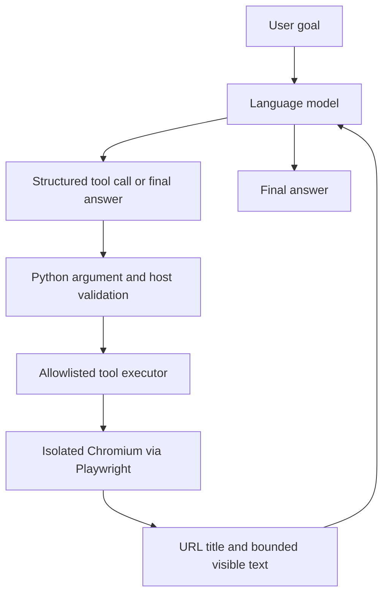

# Day 39 — Build an AI + Playwright Browser Agent

A small, supervised browser-agent experiment: a language model selects a browser tool, Python checks its arguments, and Playwright executes the permitted action in an isolated Chromium context. The resulting page observation is sent back to the model so it can decide what to do next.

> **The model chooses an action; Python validates and executes it; Playwright interacts with the browser; the resulting observation provides feedback.**

Playwright is a browser automation library, not an AI model. This project uses an OpenAI-compatible chat-completions endpoint for the model and function/tool calling.

## Day 39 objective

Learn the AI-to-browser control loop by running a harmless research task, rather than a fixed sequence of browser actions:

> “Find the official Python website, inspect its homepage, and report the page title and a short description based on the page content.”

The browser starts at `https://example.com/`. The model is expected to choose when to navigate to `https://www.python.org/`, inspect the page, and report what it observed.

### Learning goals

- Distinguish model reasoning from browser automation.
- Understand structured tool calling and the model/executor boundary.
- Validate model-supplied arguments before execution.
- Use Playwright locators and browser observations.
- Bound the agent loop and handle invalid calls, timeouts, and failures.
- Apply an allowlist and treat page content as untrusted input.
- Test agent behavior without a live model or external network.

## Architecture and control loop



The loop is **observe → decide → validate → execute → observe → decide**:

1. Open the approved initial page in a fresh, temporary browser context.
2. Send the user's goal and initial observation to the model.
3. Receive one structured tool call, or a final text answer.
4. Check tool name, argument shape, URL scheme, hostname, and port in Python.
5. Run the allowed operation through a narrow Playwright wrapper.
6. Return the operation result and updated page state to the model.
7. Stop on a final answer, a failure threshold, or the round limit.
8. Close the browser context and browser, including when an exception occurs.

The model can request only `navigate`, `read_page`, `click_text`, or `finish`. It cannot run shell commands, Python, arbitrary JavaScript, or filesystem operations. The page observation is DOM/text-based; screenshots are not sent to the model and this is not a vision-driven computer-use system.

## Project structure

```text
day-39/
├── main.py                 # CLI and browser-session lifecycle
├── browser_agent.py        # Tool schemas, prompts, bounded model/tool loop
├── browser_tools.py        # URL policy and Playwright executor
├── model_client.py         # OpenAI-compatible tool-calling client
├── requirements.txt
├── .env.example
├── .gitignore
├── screenshots/            # Optional local screenshots; ignored by Git
└── tests/
    └── test_browser_agent.py
```

## Requirements

- Windows 10/11 and PowerShell
- Python 3.11 or newer; this workspace was detected with Python **3.14.2**
- An OpenAI-compatible chat-completions endpoint that supports function/tool calling
- A model name and API key for a live run
- Chromium installed by Playwright

Python 3.14.2 was already available; this project uses a local `.venv` and does not change the system Python installation.

## Setup (PowerShell)

From the repository root:

```powershell
Set-Location .\day-39
py -3 -m venv .venv
.\.venv\Scripts\Activate.ps1
python -m pip install --upgrade pip
python -m pip install -r requirements.txt
python -m playwright install chromium
```

If `py -3` does not select the interpreter you want, create the environment with its full executable path, for example:

```powershell
& "C:\Users\<you>\AppData\Local\Programs\Python\Python314\python.exe" -m venv .venv
```

If PowerShell blocks activation, either use `Set-ExecutionPolicy -Scope Process -ExecutionPolicy Bypass` for that terminal only, or run the environment's executable directly:

```powershell
.\.venv\Scripts\python.exe -m pip install -r requirements.txt
.\.venv\Scripts\python.exe -m playwright install chromium
.\.venv\Scripts\python.exe -m pytest -q
```

The dependencies are limited to the OpenAI Python client, Playwright, `python-dotenv`, and `pytest`. Chromium is installed into Playwright's browser cache, not committed to this repository.

## Configure the model

Copy the example file, then edit the local copy:

```powershell
Copy-Item .env.example .env
notepad .env
```

Set values for the selected compatible provider:

```dotenv
MODEL_PROVIDER=openai_compatible
OPENAI_API_KEY=your_key_here
OPENAI_BASE_URL=
OPENAI_MODEL=your_tool_calling_model
```

`OPENAI_BASE_URL` may be left empty for the OpenAI API or set to the provider's documented compatible API base URL. Compatibility varies: verify that the endpoint supports chat completions and function/tool calling. Never put credentials in source files or commit `.env`. The client and logs do not print the API key.

## Run

With the virtual environment active, from `day-39`:

```powershell
python main.py
```

The harmless experiment described above is the default. To provide another goal or see the isolated browser window:

```powershell
python main.py --goal "Read the Python homepage and summarize what Python is." --headed
```

The agent uses a maximum of **8 model rounds**, a **10-second** navigation/locator timeout, a **4,000-character** page-text limit, and stops after **2 consecutive failed tool calls**. Tool calls are executed one at a time.

## Safety boundaries and limitations

- Only credential-free HTTPS URLs at the exact hosts `example.com` and `www.python.org` are allowed; non-default ports are rejected.
- A fresh non-persistent browser context is used; downloads are disabled and service workers are blocked.
- Every browser request is checked by Playwright routing, including redirects and page subresources. Requests outside the allowlist are aborted.
- Link clicks must identify one visible accessible link, open in the same tab, and point to an approved HTTPS destination.
- The model has no shell, arbitrary code, form-submission, file, or account-management tool.
- Website text is untrusted data and cannot change the allowlist or tool definitions.
- The page text and final answer are model inputs/outputs, not proof of an action by themselves. The returned browser URL and title are separately reported for verification.

**Important:** application-level URL validation and Playwright request routing are defense-in-depth, not a complete network security boundary. They do not replace OS-level sandboxing, a restricted proxy/firewall, or a disposable VM. If working with sensitive data, do not run this experiment in a logged-in browser or a trusted network context.

## Offline tests

No model API call or public website access is needed for the test suite:

```powershell
python -m compileall -q .
python -m pytest -q
```

The tests cover approved/rejected URLs, rejection before navigation, exact tool argument validation, unknown tool names, malformed tool JSON, round limits, navigation timeouts, final model responses, `finish`, and browser cleanup after an exception. Fake pages and model turns keep these tests offline.

## Verification record

This section is updated with the checks actually run in this workspace. The live task is recorded only if a configured model was available and the browser operation was observed.

- Python version: **3.14.2** (detected from the existing system interpreter).
- Local `.venv`: **created and verified**.
- Installed direct dependencies: OpenAI **2.54.0**, Playwright **1.63.0**, `python-dotenv` **1.2.4**, and pytest **8.4.2**; `pip check` reported no broken requirements.
- Playwright Chromium: **installed**.
- Python compilation: **passed**. Offline tests: **19 passed**.
- Browser-only smoke test: Playwright navigated to `https://example.com/`; the observed title was **Example Domain**. This did not use a model.
- Live model/browser experiment: **not run**. No `OPENAI_API_KEY` or `OPENAI_MODEL` environment variable is configured, and no local `.env` exists.

## Troubleshooting

| Symptom | What to check |
|---|---|
| `OPENAI_API_KEY is not configured` | Create `.env` from `.env.example` and set a valid key locally. |
| Provider rejects `tools` or `tool_choice` | Confirm the endpoint supports chat-completions function calling and use its documented base URL/model. |
| Playwright cannot find Chromium | Activate `.venv`, then run `python -m playwright install chromium`. |
| Navigation reports blocked | Only the two exact allowlisted hosts are supported. Review redirects and external resources; do not broaden the allowlist casually. |
| Page observation is empty or clipped | The tool returns at most 4,000 characters of visible body text. A page may require a different safe observation strategy. |
| API/network timeout | Verify provider availability and network access; tests can still run offline. |

## What I learned and what remains limited

The core lesson is that browser agents are not magic browser access: the model proposes a structured action, application code validates it, and a separate executor performs it. Returning fresh observations closes the feedback loop. Narrow tools, round limits, timeouts, and URL controls help make the experiment understandable and bounded.

This is an educational prototype. It supports one OpenAI-compatible chat-completions interface, a tiny static host allowlist, text/DOM observations, and simple link navigation. It is not a production security sandbox, does not verify claims in model prose semantically, and does not use screenshots or vision models.

## Official references

- [Playwright for Python — Installation](https://playwright.dev/python/docs/intro)
- [Playwright for Python — Locators](https://playwright.dev/python/docs/locators)
- [Playwright for Python — Screenshots](https://playwright.dev/python/docs/screenshots)
- [OpenAI — Function calling](https://developers.openai.com/api/docs/guides/function-calling)

## Git workflow

Review only the Day-39 changes before committing:

```powershell
git status --short
git add day-39
git diff --cached --check
git diff --cached
git commit -m "Day 39: Build AI-driven Playwright agent" -m "Co-authored-by: Copilot <223556219+Copilot@users.noreply.github.com>"
```

The Day-39 project does not require a nested Git repository. Do not stage `.env`, `.venv`, or generated screenshots. The project `.gitignore` excludes them; do not push unless you explicitly intend to.

## Final summary

**AI decides → Python validates → Playwright executes → the browser provides feedback → AI decides again.** A trustworthy learning record distinguishes offline tests from a live model run and reports only observations that were actually verified.
