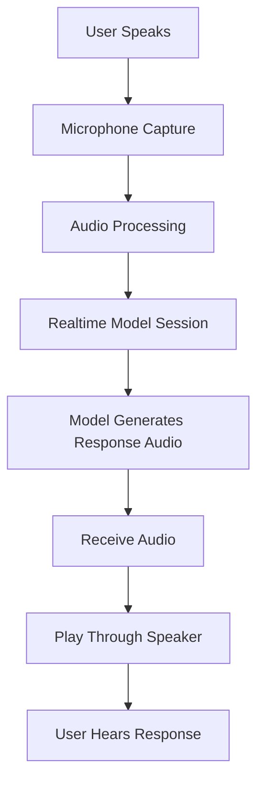

# 🎙️ Day 12 — Realtime Voice AI

> Exploring modern realtime voice systems and building a voice → model → voice interaction loop.

## 📌 Overview

Day 12 focuses on **Realtime Voice AI**: AI systems that receive spoken input and generate spoken responses, with the goal of making interactions feel more natural and immediate.

The objective is to understand how audio input, AI inference, audio generation, streaming, and conversational turn-taking fit together in a voice application.

The central experiment is:

**Voice → Model → Voice**

```text
User speaks
    ↓
Microphone captures audio
    ↓
Audio is processed and sent to the model
    ↓
The model understands the request
    ↓
The model generates a response
    ↓
Response audio is received
    ↓
Speaker plays the response
```

The focus is not simply to make an AI speak. It is to understand how a voice interaction system connects its input, model, and output components.

---

## 🎯 Today's Objective

Build a minimal voice interaction that allows me to speak a short question and hear the AI's response.

### Learning goals

- Understand realtime voice AI architecture.
- Learn the difference between speech-to-text, text-to-speech, and speech-to-speech.
- Understand how microphone audio reaches an AI model.
- Understand how model-generated audio is returned and played.
- Learn the basics of audio streaming and latency.
- Understand voice activity detection and turn-taking.
- Explore interruptions and conversational session state.
- Learn the role of WebSockets and WebRTC.
- Run a small voice interaction experiment.
- Document the implementation, test results, limitations, and learnings.

---

## 🧠 1. What Is Realtime Voice AI?

Realtime Voice AI enables an AI system to interact with a user through spoken audio while the conversation is happening.

A traditional text interaction looks like:

```text
Type message → Model → Text response
```

A voice interaction looks like:

```text
Speak → Audio input → AI → Audio response → Listen
```

A realtime voice system can process and generate audio incrementally, potentially allowing it to begin responding before a conventional record-then-process pipeline has completed every stage.

Realtime does not mean zero latency. Network communication, audio processing, model inference, and playback still take time.

The goal is to reduce unnecessary delays and make the conversation feel natural.

---

## 🔀 2. Three Voice AI Architectures

### Architecture A — Chained Voice Pipeline

A chained system uses separate stages for speech recognition, language generation, and speech synthesis.

```text
Microphone
    ↓
Speech-to-Text (STT)
    ↓
Recognized Text
    ↓
Large Language Model (LLM)
    ↓
Generated Text
    ↓
Text-to-Speech (TTS)
    ↓
Speaker
```

**Advantages**

- Easy to understand and debug.
- Each stage can be tested independently.
- The recognized transcript can be inspected.
- Individual components can be replaced.

**Limitations**

- Multiple stages can add latency.
- Errors in transcription can affect the final answer.
- Intermediate text may not preserve every aspect of the speaker's tone or emotion.

### Architecture B — Native Speech-to-Speech

A speech-to-speech model directly processes audio input and generates audio output.

```text
Microphone
    ↓
Realtime Speech Model
    ↓
Generated Audio
    ↓
Speaker
```

**Advantages**

- Designed for direct audio interaction.
- Can support natural turn-taking and low-latency responses.
- May preserve more conversational audio information than a text-only intermediate pipeline.

**Limitations**

- Session management and audio streaming can be more complex.
- Debugging may require inspecting audio events and optional transcripts.
- Availability, pricing, and supported features depend on the provider and model.

### Architecture C — Realtime Voice Agent With Tools

A voice agent can also use tools to perform tasks.

```text
User speaks
    ↓
Realtime model
    ↓
Answer directly OR request a tool
    ↓
Application validates and executes tool
    ↓
Tool result returns to model
    ↓
Spoken response
```

This is useful when building voice assistants that can interact with external systems.

Tool execution requires explicit permissions, validation, error handling, and appropriate human confirmation for sensitive operations.

---

## 🎧 3. Core Components

| Component | Responsibility |
|---|---|
| Microphone | Captures the user's speech |
| Audio capture | Reads audio from the input device |
| Audio encoding | Represents audio in the format expected by the API |
| Realtime connection | Transports session events and audio |
| AI model | Understands the request and generates a response |
| Audio output | Receives the generated audio |
| Playback system | Plays the response through speakers or headphones |
| Session manager | Handles connection state and conversation lifecycle |

The exact architecture depends on whether the implementation uses a chained pipeline or a native speech-to-speech API.

---

## 🔊 4. Audio Fundamentals

### Sample rate

The sample rate indicates the number of audio samples captured per second.

Examples:

- 16 kHz = 16,000 samples per second.
- 24 kHz = 24,000 samples per second.
- 48 kHz = 48,000 samples per second.

The correct sample rate depends on the API and audio format.

### Audio channels

- Mono: one audio channel.
- Stereo: two audio channels, typically left and right.

### PCM

Pulse-Code Modulation (PCM) is a common representation of digital audio samples.

For example, Google's Gemini Live API documentation uses raw 16-bit, little-endian PCM audio at 16 kHz for input in its documented example. Its audio output uses a 24 kHz sample rate. These are API-specific format details, not universal requirements for every voice model.

### Audio chunks

Instead of waiting for an entire recording, a streaming application can transmit smaller chunks of audio as they arrive.

```text
Audio Chunk 1 → Model
Audio Chunk 2 → Model
Audio Chunk 3 → Model
Audio Chunk 4 → Model
```

The client must follow the selected API's required audio encoding, timing, and event-ordering rules.

---

## 🧩 5. Important Terminology

### STT — Speech-to-Text

Converts spoken audio into text.

### LLM — Large Language Model

Interprets the request and generates a response in a chained voice architecture.

### TTS — Text-to-Speech

Converts text into spoken audio.

### Speech-to-Speech

A model processes audio input and generates audio output without requiring a separately exposed STT-to-LLM-to-TTS pipeline.

### Streaming

Transfers or generates data incrementally rather than waiting for an entire response.

### Latency

The delay between speaking and hearing the response.

### VAD — Voice Activity Detection

Detects whether speech is present and can help manage the start and end of spoken turns.

### Endpointing

Determines when the speaker has probably finished a turn.

### Turn-taking

Coordinates when the user speaks and when the assistant responds.

### Barge-in

Allows the user to interrupt the assistant while it is speaking.

### Session state

Information about the active connection and conversation, including relevant previous turns.

---

## 🌐 6. WebSockets vs WebRTC

### WebSockets

A persistent, bidirectional connection that supports messages and events in both directions.

Typical use:

```text
Python Backend ↔ Realtime Model
```

This is useful for server-side audio pipelines that need explicit control over audio events.

### WebRTC

A technology designed for realtime communication, including audio and video streams.

Typical use:

```text
Browser Microphone ↔ Realtime Voice Service
```

WebRTC is particularly useful for browser-based voice interfaces.

These technologies transport data; they are not AI models.

The correct choice depends on the provider, client environment, and required session architecture.

---

## 🏗️ 7. Project Architecture

The target experiment uses this flow:



The actual implementation may use a chained pipeline or a native speech-to-speech model. The final architecture diagram should be updated if the implementation differs from this target.

---

## 🛠️ 8. Technologies

The intended implementation can use:

- Python for application logic.
- A supported realtime voice API.
- An SDK for connecting to the selected model.
- Microphone and audio playback libraries appropriate for the operating system.
- Environment variables for API credentials.

Potential providers include:

- Google Gemini Live API.
- OpenAI Realtime API.
- ElevenLabs Conversational AI.

These providers have different connection protocols, model capabilities, configuration requirements, and pricing.

Choose one provider for the initial experiment instead of attempting to integrate all of them at once.

---

## 📁 9. Suggested Project Structure

```text
Day_12_Realtime_Voice_AI/
│
├── README.md
├── main.py
├── requirements.txt
├── .env.example
├── .gitignore
├── src/
│   ├── audio_input.py
│   ├── voice_session.py
│   └── audio_output.py
└── tests/
    └── test_config.py
```

For the first working prototype, these components can remain in `main.py`. Splitting them into separate modules is optional and should improve clarity rather than introduce unnecessary complexity.

Never commit `.env`, API credentials, or recorded private audio to GitHub.

---

## 🧪 10. Hands-On Experiment

### Experiment goal

Speak a short question and hear an AI-generated spoken response.

Example input:

> Explain what an AI agent is in simple words.

### Expected interaction

```text
1. Start the application.
2. Request microphone access.
3. Speak a short question.
4. Send audio to the model.
5. Receive the model's response.
6. Play the response audio.
7. Verify that the response was audible and relevant.
```

If the selected API supports conversational session state, ask a follow-up question and verify that the model uses the previous conversation appropriately.

### What to observe

- Was microphone input captured successfully?
- Was the audio accepted by the API?
- Did the model return a response?
- Did the application receive audio output?
- Was the audio played correctly?
- Was the response understandable?
- How long did the interaction take?
- Did the session terminate cleanly?

The experiment is complete only when the spoken input and spoken output have both been verified.

---

## ⏱️ 11. Measuring Latency

For a chained pipeline, a simplified response-time estimate is:

```text
Total Response Time
≈ Audio Capture
+ Speech Recognition
+ Model Inference
+ Speech Synthesis
+ Playback Delay
```

Some stages can overlap, so this is an approximation rather than a universal timing formula.

Useful metrics include:

| Metric | Purpose |
|---|---|
| Input processing time | Time spent capturing and processing audio |
| Time to first response | Delay before the model starts responding |
| Time to first audio | Delay before the user hears the response |
| Total response duration | Time until the answer finishes |
| Turn completion | Whether the interaction finishes correctly |
| Interruption handling | Whether the assistant responds appropriately to a new user turn |

Record actual measurements if available. Do not invent latency values.

---

## 🔐 12. Privacy and Safety

Microphone input can contain sensitive information.

For this experiment:

- Use short, non-sensitive questions.
- Request microphone permission explicitly.
- Avoid recording continuously in the background.
- Do not speak passwords or confidential information.
- Store only the audio and transcripts needed for the experiment.
- Keep API credentials out of source code and GitHub.
- Close the session and release audio resources when finished.
- Check the selected provider's current data-handling and retention policies.

---

## 📊 13. Results

**Complete this section after running the experiment.**

| Check | Result |
|---|---|
| Environment created | Pending verification |
| Dependencies installed | Pending verification |
| API connection established | Pending verification |
| Microphone input captured | Pending verification |
| Model response received | Pending verification |
| Response audio played | Pending verification |
| Follow-up question tested | Pending verification |
| Latency measured | Pending verification |

Do not mark an item as successful until it has actually been tested.

### Experiment notes

- Selected provider/model: To be recorded
- Architecture: To be recorded
- Input question: To be recorded
- Observed output: To be recorded
- Response latency: To be measured
- Errors encountered: To be recorded
- Improvements: To be recorded

---

## 💡 14. What I Learned

After completing the experiment, record the key lessons:

1. How audio travels from the microphone to the model.
2. How the model's response becomes playable audio.
3. How realtime streaming differs from processing a completed recording.
4. Why sample rate and audio encoding matter.
5. Why latency and turn-taking affect conversational quality.
6. How session management keeps the interaction working.
7. What safety and privacy controls are needed for voice applications.

---

## 🚀 15. Future Improvements

Possible extensions after the minimum experiment works:

- Continuous conversational sessions.
- Streaming speech output.
- Displaying partial transcripts.
- Better turn-taking and endpointing.
- Handling interruptions.
- Conversation memory.
- Tool calling from a voice assistant.
- Browser-based microphone and speaker interface.
- Latency measurement and optimization.
- Comparison of native speech-to-speech with a chained voice pipeline.

These are future improvements, not requirements for the initial experiment.

---

## 📚 16. Official References

- [Google Gemini Live API overview](https://ai.google.dev/gemini-api/docs/live-api)
- [Google Gemini Live API — Python quickstart](https://ai.google.dev/gemini-api/docs/live-api/get-started-sdk)
- [Google Gemini Live API capabilities](https://ai.google.dev/gemini-api/docs/live-api/capabilities)
- [OpenAI Realtime API](https://developers.openai.com/api/docs/guides/realtime)
- [OpenAI Realtime conversations](https://developers.openai.com/api/docs/guides/realtime-conversations)
- [OpenAI audio and voice guide](https://developers.openai.com/api/docs/guides/audio)
- [ElevenLabs Conversational AI](https://elevenlabs.io/docs/eleven-agents/build/overview)

---

## 🏁 Final Summary

Day 12 explores how AI systems can interact with people through spoken language.

The central architecture is:

```text
VOICE INPUT
    ↓
AUDIO PROCESSING
    ↓
AI MODEL
    ↓
GENERATED AUDIO
    ↓
VOICE OUTPUT
```

The most important distinction is between a chained pipeline, where speech recognition, text generation, and speech synthesis are separate stages, and native speech-to-speech, where a realtime model directly handles audio input and output.

The experiment's goal is simple: **speak a question, receive an AI response, and hear that response spoken aloud.**

> **Day 12 takeaway:** Realtime Voice AI combines audio processing, model inference, streaming, and conversational turn management to create a spoken interaction loop.
